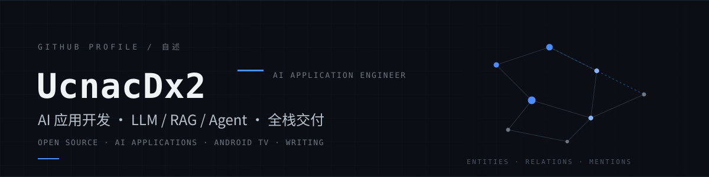
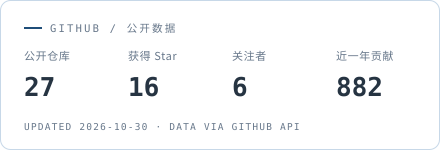
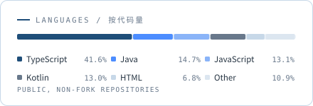

  

  
  

把大模型接进真实业务流程时，我先划边界：**状态流转、金额与权限用状态机和数据库事务兜底，非结构化检索与归纳才交给模型**，再补齐引用溯源、超时回退与人工接管。

两套生产系统：多租户法律知识库（RAG / GraphRAG / 多智能体）与上门服务 SaaS（16 状态履约状态机 + 多角色终端）。业余维护 Android TV 与 OpenList 生态的开源项目。

---

### 数据 / By the numbers

  <picture>
    <source media="(prefers-color-scheme: dark)" srcset="./assets/stats-dark.svg" />
    
  </picture>
  <picture>
    <source media="(prefers-color-scheme: dark)" srcset="./assets/langs-dark.svg" />
    
  </picture>

---

### 代表项目 / Selected work

| 项目 | 它解决什么问题 | 技术 |
| --- | --- | --- |
| **[singbox-ktv](https://github.com/UcnacDx2/singbox-ktv)** | 把 Android TV 盒子变成 KTV：手机扫码进控制页、YouTube / Bilibili / 网易云多源解析、DLNA 投屏、异地 8 位 PIN 遥控；逐字字幕与日文注音。四种 ABI 的 APK 由 CI 构建发布 | TypeScript · Kotlin · Media3 · Cloudflare |
| **[wisestu-auto-sign](https://github.com/UcnacDx2/wisestu-auto-sign)** | 实习签到自动化：用 LLM 识别图片验证码，Cron 定时执行，内置网络与签到失败重试 | Go · YAML |
| **[mitv-ota-monitor](https://github.com/UcnacDx2/mitv-ota-monitor)** | 小米电视 OTA 监测与社区共建：逆向官方 `checkUpdate` 签名协议，Cloudflare D1 持久化；贡献者提交的 SN 只在单次请求内存活，绝不落库 | TypeScript · Workers · D1 |
| **[codex-quota-resumer](https://github.com/UcnacDx2/codex-quota-resumer)** | 通过 Codex app-server 协议恢复配额受限的线程：操作系统级单实例锁、失败即关闭、不重复启动 turn | Python · Windows 计划任务 |

其他：**[NetCertFix](https://github.com/UcnacDx2/NetCertFix)**（LSPosed 模块，代理可用时抑制 ChatGPT 客户端的伪证书全屏拦截）、**[mitv-home-bridge](https://github.com/UcnacDx2/mitv-home-bridge)**、**[openlist-share-tool](https://github.com/UcnacDx2/openlist-share-tool)**、**[mitv-optimizer](https://github.com/UcnacDx2/mitv-optimizer)**。

---

### 开源贡献 / Open source

**OpenListTeam** · Member — 维护 [OpenList](https://github.com/OpenListTeam/OpenList)（25k+ stars）的 139 云盘驱动

- 认证与批量文件操作链路：[#1534](https://github.com/OpenListTeam/OpenList/pull/1534)、[#2067](https://github.com/OpenListTeam/OpenList/pull/2067)，前置工作 [AList #9567](https://github.com/AlistGo/alist/pull/9567)，均已合并
- 统一 Authorization 与 Cookie 快速登录并保留密码回退，处理失效凭证、重定向与敏感信息脱敏；补充由环境变量控制的集成测试与认证配置文档

**[Bilibili-Evolved](https://github.com/the1812/Bilibili-Evolved)**（30k+ stars）· [PR #5226](https://github.com/the1812/Bilibili-Evolved/pull/5226) 已合并
独立实现推荐流封面替换：Canvas 实时截取视频帧生成预览图，MutationObserver 监听动态列表做低开销增量渲染。

**[BiliRoaming](https://github.com/yujincheng08/BiliRoaming)**（11k+ stars）· [commit 15c6a64](https://github.com/yujincheng08/BiliRoaming/commit/15c6a643b4b2ed8c70f7ab1ce36ed7b02d980405)
追踪运行时内容过滤调用链，定位热门页规则未覆盖 `TOPIC_LIST` 类型的问题并补齐。

---

### 闭源项目 / Closed-source work

> 代码不在公开仓库，这里只记录工程决策和验证结果。

**多租户法律知识库与智能问答平台**
FastAPI · PostgreSQL/pgvector · Neo4j · LangGraph

- 把法条、司法解释、裁判文书与内部模板整理成「实体—关系—提及」图谱，解决同一当事人、案由在不同文书中的别名与重名；自动建图会污染主数据，因此设计人工规则优先的增量合并与一致性校验
- 每个结论强制绑定文档名、页码与原文片段；相关度低于 0.3 的边缘内容只注入上下文、不在前端展示引用，兼顾召回与阅读信任
- 按业务复杂度分级编排直答与深度研究，建立固定评测集驱动迭代：从 0.57 的基线里定位出「工具只回传摘要导致漏答」和「常识问题不检索、凭记忆作答」两处缺陷，修复后忠实度 0.99、引用正确性 0.93、综合 0.96
- 统一网关接入 8 家模型厂商，租户自带 Key 加密托管；Redis 租户配额限流、退避重试与熔断，并按租户核算 Token 成本

**上门服务 SaaS（预约 · 派单 · 履约）**
Vue 3 · uni-app · NestJS · Prisma · MySQL · Redis

- 把零散的云函数收敛为 NestJS 模块化单体，线下作业收敛为 16 状态有限状态机，约束接单、到达、履约拍照留证、核销到售后的流转边界
- 用「订单状态 + 服务方空闲」条件原子更新处理高峰期并发抢单；支付、优惠券与套餐权益统一走数据库事务，消除多资源部分更新导致的状态错乱
- 高频咨询走检索增强并流式带来源回答；识别到退款、投诉等高风险意图时自动拦截转人工
- 派单只在候选排序环节引入模型打分，时段冲突、技能匹配与并发锁由数据库规则兜底；后端 15 个测试套件、88 个用例，配 CI/CD 与多环境隔离

---

### 技术栈 / Stack

  
  
  
  
  
   
  
  
  
  
  
  
   
  
  
  
  
  
   
  
  
  
  
  
  

---

### 写作 / Writing

在 [ucnacdx2.github.io](https://ucnacdx2.github.io) 记录踩坑，共 17 篇，主要是协议逆向、状态机切分和真实故障复盘：

- [OpenList 139 云盘鉴权重构：我到底改了哪四个文件](https://ucnacdx2.github.io/blog/openlist-139-driver-debugging/)
- [SingBox KTV 从 Demo 到 0.9.12：状态、解析、播放和 Android 系统边界](https://ucnacdx2.github.io/blog/singbox-ktv-architecture/)
- [MiTV OTA 机型库怎么落地：ADB 采集、在线验证和敏感字段加密](https://ucnacdx2.github.io/blog/mitv-ota-device-database/)
- [从单商户到多租户：一次上门服务项目的真实架构演进](https://ucnacdx2.github.io/blog/car-wash-saas-lessons/)

---

  中文 / English · 欢迎通过 <a href="https://ucnacdx2.github.io">博客</a> 或任意仓库的 Issue 找到我

